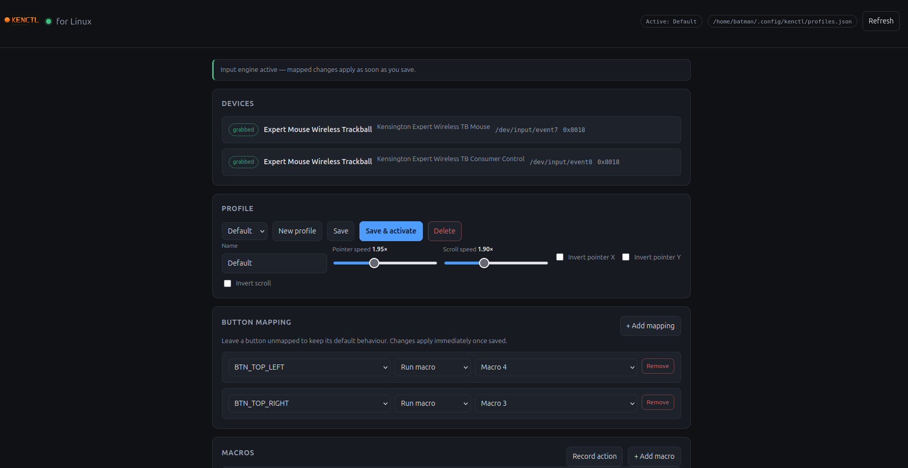
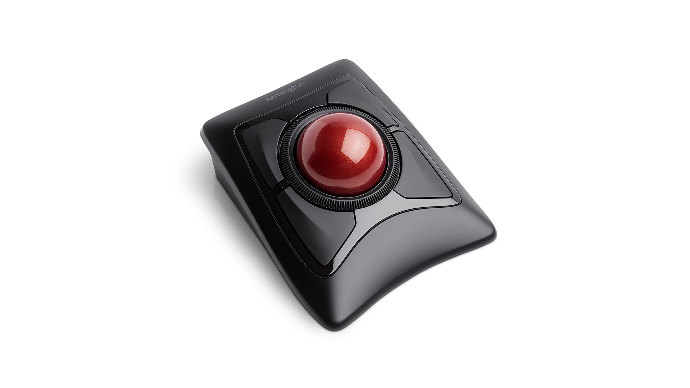
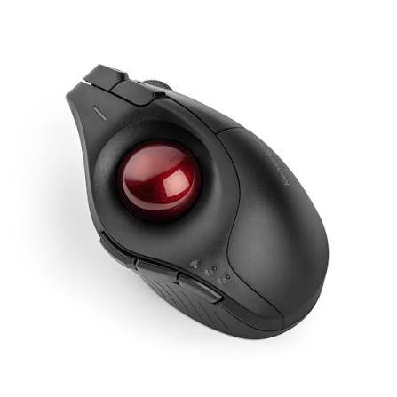

<div align="center"> <h1>KenCtl</h1>               

<p> 
</p>

<p> Linux configuration for Kensington mouse/trackballs button remapping, pointer and scroll tuning, profiles, and a macro recorder, with a local web UI. </p> </div>

Not affiliated with Kensington Technology Group. “Kensington”, “Expert Mouse”, “SlimBlade”, and “Konnect” are trademarks of their respective owners. KenCtl is an independent Open-Source, host-side implementation Linux Tool; it does not modify device firmware.

## Status

Early alpha. Developed and tested on the **Kensington Expert Mouse Wireless
Trackball (K72359WW, `047d:8018`)**. Other supported Kensington trackballs are
detected, but button layouts may vary. 

<div align="left">

Also, tested on **Kensington ProFit Ergo Vertical Wireless Trackball** the BTN_MIDDLE can be used as forward and BTN_SIDE can be used as Browser Backward Macros once you record the actions.

<div align="Left">

## Quick Install
### Linux/Debian
```bash
curl -fsSL https://raw.githubusercontent.com/parzival0037/kenctl/main/install-remote.sh | sudo bash
```

This downloads the latest release, sets up `/dev/uinput`, installs
`~/.local/bin/kenctl` and the systemd user service, then enables it.

Prebuilt releases are currently x86_64 only. Method 1 needs a published GitHub
release; if none is available yet, use Method 2. To inspect the script first:

```bash
curl -fsSL https://raw.githubusercontent.com/parzival0037/kenctl/main/install-remote.sh | less
```
See below for Method-1, Method-2 for installing from source or manual install.


## Supported hardware

Detection is generic: any Kensington input device (`047d:*`) is discovered, and
an unknown PID is still usable as `Kensington device (0x....)`. The table below
is the vendor model set. **Only the Expert Mouse Wireless Trackball has been
hardware-tested.**

| Family | USB PID(s) |
|---|---|
| Expert Mouse Wireless Trackball | `0x8018`, `0x8019` (JP) |
| Expert Mouse Wired Trackball | `0x1020` |
| Expert Mouse TB800 EQ | `0x8168`, `0x8169`, `0x816A` |
| Expert Mouse TB900 EQ | `0x823B` |
| SlimBlade Trackball | `0x2041`, `0x80BC` |
| SlimBlade Pro Trackball | `0x80D4`–`0x80D7` |
| Orbit Wireless Mobile 2.4G | `0x8002` |
| Orbit Trackball with Scroll Ring | `0x2048` |
| Orbit Wireless with Scroll Ring | `0x80A6`–`0x80A8` |
| Orbit Fusion Wireless Trackball | `0x807B` |
| Orbit Wireless Mobile 2.4G & BT | `0x80C1`–`0x80C3` |
| Pro Fit Ergo Vertical Wired Trackball | `0x809D` |
| Pro Fit Ergo TB450 | `0x80FA`–`0x80FC` |
| Pro Fit Ergo TB550 | `0x80FD`–`0x80FF` |
| Pro Fit Ergo TB675 Vertical Wireless | `0x8213`, `0x8214`, `0x8220` |
| Pro Fit Ergo TB675 Vertical Wired | `0x8215` |
| Pro Fit Ergo Vertical Trackball | `0x8068` |
| MY230 EQ Rechargeable Mouse | `0x8156`, `0x8158` |
| Pro Fit Ergo Vertical Mouse | `0xFA67` |
| Pro Fit Ergo Wireless Mouse | `0x805B`, `0x0040` |
| Pro Fit Ergo Wired Mouse | `0x08A0` |
| MY430 Ergo Wireless Mouse | `0x8112`, `0x8138`, `0x8188` |
| Pro Fit Ergo MY630 EQ Rechargeable Mouse | `0x8143`, `0x8145` |
| Pro Fit Left-Handed Ergo Wireless Mouse | `0x4102` |
| MY435 EQ Rechargeable Mid-Size Mouse | `0x8207`, `0x8208` |
| MY435 EQ Wired Mid-Size Mouse | `0x8209` |

The classic Expert Mouse family (`0x8018`, `0x8019`, `0x1020`) also gets
positional labels (`BTN_TOP_LEFT`, `BTN_TOP_RIGHT`, `BTN_BOTTOM_RIGHT`,
`BTN_BOTTOM_LEFT`). Other models expose their raw evdev button names.

## Features

- Remap any trackball button to a key, mouse button, or nothing.
- Hold modifiers (Ctrl/Shift/Alt/Meta) with correct shared release.
- Adjust pointer speed and invert X/Y.
- Adjust scroll speed and invert direction (legacy + hi-res wheel).
- Profiles stored as JSON, hot-switchable from the UI or CLI.
- Macro recorder: capture keyboard/mouse actions, including chords such as
  `Alt+Left` / `Alt+Right` for browser back/forward, then assign them to buttons.
- Local web UI at `http://127.0.0.1:3789/`; no cloud, no telemetry.
- Dry-run CLI prototypes for checking mappings without root or `/dev/uinput`.

## How it works

```
Kensington evdev node(s) --EVIOCGRAB--> transform --uinput--> desktop
                                         ^
                                  active profile (JSON)
```

The daemon grabs the trackball's evdev nodes, applies the active profile, and
re-injects events through a virtual uinput device. Everything runs on the host;
no vendor protocol or firmware changes are involved. Because it works at the
input layer, it is independent of X11 vs. Wayland.

## Requirements

- Linux with evdev and uinput.
- The user must be in the `input` group and able to open `/dev/uinput`.
- A systemd user session (for the autostart service).
- **Method 1:** x86_64 Linux, `curl`, and `tar`.
- **Method 2:** a recent stable Rust toolchain.

## Install

### Method 1 — Quick Install
## Linux/Debian
```bash
curl -fsSL https://raw.githubusercontent.com/parzival0037/kenctl/main/install-remote.sh | sudo bash
```

This downloads the latest release, sets up `/dev/uinput`, installs
`~/.local/bin/kenctl` and the systemd user service, then enables it.

Prebuilt releases are currently x86_64 only. Method 1 needs a published GitHub
release; if none is available yet, use Method 2. To inspect the script first:

```bash
curl -fsSL https://raw.githubusercontent.com/parzival0037/kenctl/main/install-remote.sh | less
```

### Method 2 — build from source

```bash
git clone https://github.com/parzival0037/kenctl.git
cd kenctl
cargo build --release --locked
sudo ./install.sh
```

This builds locally and installs the same binary and service.

After either method:

```bash
systemctl --user status kenctl
systemctl --user restart kenctl
journalctl --user -u kenctl -f
```

The service starts at login. If you were just added to `input`, log out and
back in once, then run `systemctl --user restart kenctl`.

## Run manually

```bash
~/.local/bin/kenctl run
# or from a source checkout: ./target/release/kenctl run
# open http://127.0.0.1:3789/
```

Stop the service first so two instances do not grab the same device:

```bash
systemctl --user stop kenctl
```

Useful commands:

```bash
kenctl devices
kenctl listen
kenctl status
kenctl profiles
kenctl activate "Work"
kenctl hardware
kenctl proto button --from BTN_SIDE --to KEY_C --modifier KEY_LEFTCTRL --dry-run
kenctl proto scroll --speed 2.0 --dry-run
```

The commands above assume `~/.local/bin` is on your `PATH`; otherwise use
`~/.local/bin/kenctl`. From a source checkout you can also use
`./target/release/kenctl`. `--dry-run` reads events without grabbing the device,
so it needs no root and no `/dev/uinput`.

## Profiles and macros

Profiles live in `$XDG_CONFIG_HOME/kenctl/profiles.json`, which defaults to
`~/.config/kenctl/profiles.json`.

To create a browser back/forward macro:

1. Open the web UI, then **Macros → Record action**.
2. Press `Alt+Left` (back) or `Alt+Right` (forward).
3. Click **Stop & add**, rename the macro, and assign it to a button under
   **Buttons**.
4. Click **Save & activate**.

The recorder writes explicit `down`/`up` steps, so chords replay correctly. A
simpler alternative is a normal key mapping to `KEY_LEFT` or `KEY_RIGHT` with
modifier `KEY_LEFTALT`.

## Development

```bash
cargo test
node --check webui/app.js
cargo build
```

The web UI is embedded into the binary at compile time (`include_str!`), so
restart `kenctl run` (or `systemctl --user restart kenctl`) after changing
`webui/`.

## Roadmap

- `v0.1.0` GitHub release and binary packaging
- broader hardware testing beyond the Expert Mouse Wireless
- per-application profiles
- curated virtual-device key set

## License

MIT — see [LICENSE](LICENSE).
